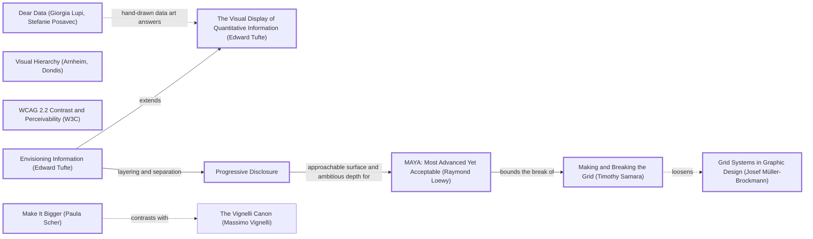

# DESIGN-LOG: Religion Map (DADA run, 2026-11-10)

## Traversal Plan

**Brief, restated:** Turn a one-page D3 bar chart of 11 religions into a multi-page atlas of where and when the world's religions began, with a light Equal Earth map of origins and spread, and a timeline that shows lineage and endings. Then add it to the PersonalPortfolio.

The owner's words were: "total review and make way better add map with lite earth and make timeliness way better design dada revamp then add to portfolio".

**Mode: Adaptive.** The site serves a public audience of students and curious readers, so MAYA governs. The advanced pole is a folded time axis tied to a map that changes with the year. The acceptable pole is plain labels, BCE/CE dates and a table under every figure.

**Run type: Full.** This is a redesign, so nothing is frozen.

**Bound:** none stated by the owner.

### Tooling inventory (Step 0)

| Job | Tool used |
|---|---|
| Render and navigate the anchor graph | None available (no Mermaid renderer). The graph is kept as Mermaid text in this log. |
| Compute the Frontier | By hand, from the edge lines of `references/anchor-graph.md` (grep). |
| Track workflow state | This log. TaskCreate was available but not used. |
| Run the panel | Agent tool: one sub-agent per seat, at most three at a time, each filing to `panel/<round>/<seat>.md`. |
| Collect panel reports | `scripts/collect_panel.py` and a directory listing. |
| Choose the panel | `scripts/pick_panel.py --mode adaptive --run-type full --project ReligonMapApp --data-graphic` |
| Brief each seat | `seats/<seat_id>.md`, with the prompt template filled in. |
| Record the run | `import_log.py` / `rate_seats.py` from the dada repo at `/home/user/dada`. |
| Measure the artifact | Playwright (Chromium) scripts in `build/check.mjs`, plus a scratch capture script. |
| Persist the log | `DESIGN-LOG.md` only. |

### Panel, from `pick_panel.py`

| Seat | Why | File |
|---|---|---|
| Critic: Provocateur (Debord) | Required by the Adaptive minimum. | `seats/crit_prov_debord.md` |
| Critic: Provocateur (Shklovsky) | Required by the Adaptive minimum. | `seats/crit_prov_shklovsky.md` |
| Critic: Inclusion (Holmes) | Required by the Adaptive minimum. | `seats/crit_inc_holmes.md` |
| Critic: Inclusion (Mace) | Required by the Adaptive minimum. | `seats/crit_inc_mace.md` |
| Critic: Evidence (Cairo) | Required: the artifact can be inspected. | `seats/crit_evid_cairo.md` |
| Critic: Evidence (Tufte) | Required: the artifact is a data graphic. | `seats/crit_evid_tufte.md` |
| Critic: Usability (Krug) | Rated 0.844 over 65 rounds. | `seats/crit_use_krug.md` |
| Critic: Rupture (Shklovsky) | Rotation seat, with 0 rounds on record. | `seats/crit_rupt_shklovsky.md` |

There are two dotted pairs: crit_prov_debord -.- crit_use_krug and crit_prov_shklovsky -.- crit_use_krug.

**Content-owner witness:** none applies. The artifact describes no system owned by another party. Its factual claims come from cited public sources (see `data/sources.json`), and Cairo audits them.

### Seed (labels copied verbatim from the graph)

- **Stance:** Make It Bigger (Paula Scher)
- **Rules:**
  - Grid Systems in Graphic Design (Josef Müller-Brockmann)
  - Visual Hierarchy (Arnheim, Dondis)
  - WCAG 2.2 Contrast and Perceivability (W3C)
- **Expression:**
  - Envisioning Information (Edward Tufte)
  - The Visual Display of Quantitative Information (Edward Tufte)
- **Breaker:** Making and Breaking the Grid (Timothy Samara)
- **Counterpoints (dotted):**
  - Dear Data (Giorgia Lupi, Stefanie Posavec): `lupiDear -.->|hand-drawn data art answers| tufteV`
  - Making and Breaking the Grid (Timothy Samara) loosens Grid Systems in Graphic Design (Josef Müller-Brockmann): `samBreak -.->|loosens| mb`
  - Make It Bigger (Paula Scher) contrasts with The Vignelli Canon (Massimo Vignelli): `scher -.->|contrasts with| vignelliCanon`

Chain:

> Make It Bigger (Paula Scher) -.contrasts with.- The Vignelli Canon · Grid Systems in Graphic Design (Josef Müller-Brockmann) -->|codifies| International Typographic Style · Making and Breaking the Grid (Timothy Samara) -.->|loosens| Grid Systems · Envisioning Information (Edward Tufte) -->|extends| The Visual Display of Quantitative Information (Edward Tufte) · Envisioning Information -->|layering and separation| Progressive Disclosure · Progressive Disclosure -->|approachable surface and ambitious depth for| MAYA: Most Advanced Yet Acceptable (Raymond Loewy) -->|bounds the break of| Making and Breaking the Grid · WCAG 2.2 -->|measurable access for| (quality attributes).

### Initial Frontier

| Candidate | Reached via | From anchor | Status |
|---|---|---|---|
| R0 objections (8 seats, below) | premortem | — | TAKEN (M1 to M7) |
| Folded time axis | samBreak -.->\|loosens\| mb | Making and Breaking the Grid | TAKEN (M3) |
| Layered map: calm default, density on demand | tufteE -->\|layering and separation\| c_prog | Envisioning Information | TAKEN (M4, M5) |
| Multi-page split under one grid | mb -->\|codifies\| itstyle | Grid Systems | TAKEN (M2) |
| Hand-made, idiosyncratic marks against Tufte minimalism | lupiDear -.-> tufteV | Dear Data | TAKEN (M8: a terminal mark for each ending, with the cause written beside it) |
| One huge hero against a quiet canon | scher -.-> vignelliCanon | Make It Bigger | TAKEN (M5) |
| MAYA bounds the break | maya -->\|bounds the break of\| samBreak | MAYA | TAKEN (M3: every fold is drawn and labelled with its ratio) |
| Accessibility floor | wcag -->\|measurable access for\| | WCAG 2.2 | TAKEN (M6) |

First moves:
- M1 data (KEEP-THE-RULE)
- M2 pages (KEEP-THE-RULE)
- M3 folded axis (BREAK)
- M4 light Equal Earth atlas (KEEP-THE-RULE)
- M5 landing (BREAK, Scher)
- M6 access layer (KEEP-THE-RULE)
- M7 deletion of the old files (KEEP-THE-RULE)
- M8 endings as events (BREAK, Lupi counterpoint)

---

## Panel, WHOLE, round R0 (premortem; artifact examined: inherited site at commit 01ad882, panel/R0/*.png)

All eight seats filed. Reports are in `panel/R0/`.

| Critic | Anchor used | Observed in the work | Verdict | Requested change |
|---|---|---|---|---|
| Critic: Evidence (Cairo) | How Charts Lie | `dead-religons.json:81` is invalid JSON. The bars overflow into other rows (script.js:46). The README's "Responsive" claim is false. Dates are falsely precise and nothing is cited. | OBJECT | Add numeric years with an approx flag, cited coordinates, and a domain taken from the data. |
| Critic: Evidence (Tufte) | Visual Display of Quantitative Information | 14 children stack 287 px (4.2 rows). 77% of the bars are unlabelled. The dead religions are never drawn. | OBJECT | Direct labels, rows sized to their children, open ends for living traditions, a fluid width. |
| Critic: Provocateur (Debord) | Society of the Spectacle | "Relationships" is promised and never drawn. There is no coordinate anywhere. The page fails when the CDN fails. | OBJECT | Draw the lineage. Add origins with uncertainty (regions, not pins). Serve d3 locally. |
| Critic: Provocateur (Shklovsky) | Art as Technique | A habitual Gantt chart that stops at a 2025 wall. The dead are buried in an unread file. | OBJECT | One device that makes time felt. Lead with the dead. Endings only for the dead. |
| Critic: Rupture (Shklovsky) | Art as Technique | The Gantt bar is the automatized form. The "now" wall. Risk that the map becomes a dot globe. | OBJECT | A non-linear time scale, endings and splits as the visible events, a map tied to time. |
| Critic: Inclusion (Holmes) | Mismatch | Hover-only, fixed 1000 px, no SVG text alternative, no BCE/CE gloss. | OBJECT | Focusable marks, a parallel list or table, BCE/CE labels, a fallback. |
| Critic: Inclusion (Mace) | Principles of Universal Design | Nothing is focusable. Targets are 20.7 px. #69b3a2 measures 2.45:1. Tooltip motion ignores reduced motion. | OBJECT | Focusable marks with rings, targets of 24 px or more, fills of 3:1 or better, reduced motion honoured. |
| Critic: Usability (Krug) | Don't Make Me Think | Fails the five-second test. No legend. Nothing looks clickable. | OBJECT | Axis, legend and a one-line description above the fold, plus tappable labels. |

**Statements of meaning:** The page claims to show relationships between religions, but it shows a stack of bars that ends at one wall.

**Andon:** none pulled. All eight objected to the inherited artifact, and those objections become the first Frontier items.

| Finding | Resolution |
|---|---|
| Cairo + Debord: dead-religons.json does not parse; dead never drawn | ADAPT (M1, M8): one new `data/traditions.json` with numeric years; the 19 ended traditions are drawn with endings |
| Cairo + Tufte + Krug + Holmes + Mace: child bars overflow into other rows | ADAPT (M3): one row per tradition, labelled, lineage drawn as connectors |
| Cairo + Debord + Tufte: dates falsely precise, unsourced; 2025 wall | ADAPT (M1): `approx` flag and `date_note` per record, sources file, living lines run to the build year and stay open |
| Debord + Cairo + Krug: no coordinates for a map | ADAPT (M1): origin lat/lon with `precision` site or region; regions drawn as halos, not pins |
| Holmes + Mace + Krug + Cairo + Tufte: fixed 1000 px, phone scroll | ADAPT (M2, M5): fluid viewBox maps; first-screen hero measured at 375 |
| Debord + Krug + Holmes + Mace: CDN failure = empty page | ADAPT (M4): all figures pre-rendered as static SVG at build; no runtime library |
| Holmes + Mace + Krug: hover-only, nothing focusable | ADAPT (M6): every mark is a link; every figure has a list or table |
| Shklovsky (Rupture) + Shklovsky (Provocateur): Gantt habit, time not felt | ADAPT (M3): folded time axis, BREAK |
| Shklovsky (both) + Debord: the map may become a dot globe | ADAPT (M4, M5): the map is tied to a year; spread routes are dated; the landing shows a moment, not an orb |
| Shklovsky (Provocateur): lead with the dead | ADAPT (M8): "Lost religions" page in the first-screen inventory; each ending drawn and its cause written |
| Mace: #69b3a2 fill 2.45:1 | ADAPT (M4): family colours chosen and measured at ≥ 3:1 on paper |

---

## Decision Records (written before each move)

## Move M1: One dataset with origins, routes and honest dates  (KEEP-THE-RULE)
Depends on: none
Anchors: Rule The Visual Display of Quantitative Information (Edward Tufte) | Counterpoint Dear Data (Giorgia Lupi, Stefanie Posavec) (dotted edge from The Visual Display of Quantitative Information)
Intent: The site's subject is where and when, so the data has to say both. One file, `data/traditions.json`, will hold each tradition with:
- numeric start and end years
- an `approx` flag and a `date_note` in words
- an origin with lat/lon and a precision of `site` or `region`
- dated spread steps, each naming the place it came from
- a parent link
- adherents only where a citable source gives them (`data/sources.json`)
Formal argument: Tufte's graphical integrity says a mark may claim no more than its data holds. The old file claimed exact years ("Orthodox Judaism −2000") and had no places at all. Lupi's counterpoint is that the uncertainty itself should be written down in words, in the record, so the `date_note` is prose and not just a flag.
Alternatives rejected:
- (a) Keep the old two files and add coordinates. Rejected: one did not parse, and both carried false dates.
- (b) Pull a large external dataset such as Wikidata. Rejected: it cannot be audited in this run, and its dates are just as falsely precise.
Consequence: About 90 records written by hand. Every printed figure must trace back to this file or to a cited source. Adherent counts are given only for the 7 traditions with a citable census or survey.
Fence: Precise data looks authoritative, which is why charts round. Here we round only where the source rounds.
Frontier effect: This opens the map (M4), the lineage (M3), the endings (M8) and the sources page.
Mode field: The advanced pole is dated routes with sourced uncertainty (Tufte). The acceptable pole is a written date note that anyone can read (Lupi).

## Move M2: Split into a multi-page atlas under one grid  (KEEP-THE-RULE)
Depends on: M1
Anchors: Rule Grid Systems in Graphic Design (Josef Müller-Brockmann) | Rule Visual Hierarchy (Arnheim, Dondis)
Intent: The site will have these pages:
- Home
- Atlas (the full map)
- Timeline (lineage)
- 8 family pages
- one page per tradition
- Lost religions (the ended traditions)
- Sources

They share one header and one 12-column grid. Each page leads with its figure.
Formal argument: Müller-Brockmann's grid gives each page the same skeleton, so a reader learns the navigation once. Visual hierarchy puts each page's one figure above its words.
Alternatives rejected:
- (a) A single scrolling page. Rejected: about 90 traditions with routes would overplot one map, and the skill requires multi-page sites.
- (b) A client-side router. Rejected: it fails without JS, and that was the R0 failure.
Consequence: About 105 static HTML files from a build script, and an inbound-link check is needed.
Fence: n/a (no rule broken).
Frontier effect: This opens the landing inventory (M5) and the link probe.
Mode field: The advanced pole is one figure per page at full width. The acceptable pole is a plain top nav with a skip link.

## Move M3: The folded time axis  (BREAK)
Depends on: M1
Anchors: Breaker Making and Breaking the Grid (Timothy Samara) | Counterpoint Grid Systems in Graphic Design (Josef Müller-Brockmann) (dotted edge "loosens" from Making and Breaking the Grid) | Welcome MAYA: Most Advanced Yet Acceptable (Raymond Loewy) (bounds the break of Samara)
Intent: Time on every chart is folded into three linear segments:
- 3500 BCE to 500 BCE: 24% of the width
- 500 BCE to 1500 CE: 38%
- 1500 CE to the present: 38%

Each fold is drawn as a visible seam with its scale ratio printed beside it. Gridline density (every 500, 100 and 50 years) shows the scale change before any words do. Each tradition gets its own row and its own line, open-ended if living and capped if ended. Each child branches from its parent's line at its start year.
Formal argument: Most splits fall after 1500 (the Reformation and the modern movements), while the oldest religions span three millennia. A linear axis either crushes the last 500 years or clips the first 3000. Samara licenses breaking the grid when the content demands it. MAYA bounds the break: the fold must be shown and quantified, never hidden.
Alternatives rejected:
- (a) A linear axis. Rejected: at 1200 px, 1500 to 2026 gets 114 px, and 12 Protestant branches collide.
- (b) A log axis of years before present. Rejected: it is continuous but unreadable for a general audience, and it distorts recent decades the most.
- (c) Two separate charts. Rejected: lineage crosses the boundary.
Consequence: Widths are not comparable across folds. A reader could misjudge durations, so every chart must print the ratio, and row tooltips and tables give the exact span.
Fence: A uniform axis exists so that equal lengths mean equal durations. We keep that within each segment and mark every place where it stops.
Frontier effect: The fold appears on the hero ribbon (M5) and on the family small multiples. Cairo must audit the printed ratios (Step 2g).
Mode field: The advanced pole is the folded, seamed axis (Samara). The acceptable pole is gridlines, BCE/CE labels and a printed ratio (MAYA).

## Move M4: Light Equal Earth atlas, pre-rendered  (KEEP-THE-RULE)
Depends on: M1
Anchors: Rule Envisioning Information (Edward Tufte) (layering and separation) | Rule WCAG 2.2 Contrast and Perceivability (W3C) | Rule Visual Hierarchy (Arnheim, Dondis)
Intent: The map is an Equal Earth projection in light tones: a paper ocean, pale ochre land and a faint graticule. Family-coloured origin marks sit on top as the only saturated layer. A region-precision origin gets a translucent halo, not a pin. Spread routes are great-circle lines with dated stops. Everything is pre-rendered to SVG at build with d3-geo, and the page JS only toggles year and route.
Formal argument: Tufte's layering puts the base map at low contrast and the data at high contrast. An equal-area projection does not inflate Europe. A light base keeps 8 hues legible. Pre-rendering answers R0's "blank page when the CDN fails".
Alternatives rejected:
- (a) A 3D globe. Rejected: Shklovsky called it a habit, and half the marks are always hidden.
- (b) Web Mercator tiles. Rejected: area distortion, a network dependency, and they are not light-earth.
- (c) Client-side d3. Rejected: the R0 failure mode.
Consequence: Land at 110m resolution is coarse at large zoom, which is fine at 1000 px. Each map adds about 40 KB of path data.
Fence: n/a.
Frontier effect: This opens the family colour contrast probe and the route-label collision check.
Mode field: The advanced pole is a map that is a moment in time and moves with the year. The acceptable pole is a familiar world outline with plain labels.

## Move M5: Landing: the map as the year's moment, with the timeline as its ribbon  (BREAK)
Depends on: M3, M4
Anchors: Stance Make It Bigger (Paula Scher) | Counterpoint The Vignelli Canon (Massimo Vignelli) (dotted "contrasts with" from Make It Bigger) | Catalog Progressive Disclosure
Intent: The first screen is one composed figure:
- the light Earth with every origin mark
- one featured route drawn and labelled (Buddhism by default, chips for five more)
- a year scrubber whose track is the folded alive-count ribbon (the Timeline page in miniature)
- the 8 family chips with counts (one per family page)
- links to Timeline, Atlas, Lost religions and Sources

Scrubbing moves the map through time.
Formal argument: Scher's "make it bigger": the map is the subject, edge to edge. Vignelli's counterpoint keeps the frame quiet: one typeface family and one grid. Progressive disclosure opens with a calm default (one route, not 90) to meet the legibility probe.
Alternatives rejected:
- (a) A headline plus cards. Rejected: it fails the bold-graphic rule.
- (b) All routes drawn at once. Rejected: that is GeoPolitics' B, overplotted.
- (c) The timeline as the hero. Rejected: it is too tall to be complete on the first screen.
Consequence: Must be complete above the fold at 1280×800 and 375×812. The route labels on a phone need a text strip, not map labels.
Fence: Restraint (Vignelli) exists so the content speaks. We break it only in scale, not in number of devices.
Frontier effect: This opens the first-screen measurement, the legibility probe and the S4 hero push.
Mode field: The advanced pole is a time-scrubbed map with a folded ribbon. The acceptable pole is one route, plain chips and a visible year readout.

## Move M6: Access layer  (KEEP-THE-RULE)
Depends on: M3, M4, M5
Anchors: Rule WCAG 2.2 Contrast and Perceivability (W3C)
Intent:
- Every mark is a link to its tradition page, with an accessible name.
- Every figure has an adjacent list or table.
- Year controls are native range inputs.
- Focus rings are 2 px or wider at 3:1 or better.
- Reduced motion is honoured.
- There is no hover-only information.
Formal argument: WCAG 2.2 makes access measurable: 1.4.11, 2.4.7, 2.5.8 and 1.4.13.
Alternatives rejected:
- (a) ARIA on SVG shapes only. Rejected: it is fragile in screen readers.
- (b) A separate "accessible version". Rejected: it is segregation (Holmes).
Consequence: The pages carry a duplicate list for each figure.
Fence: n/a.
Frontier effect: This opens the focus and target probes.
Mode field: The advanced pole is that nothing is reduced. The acceptable pole is that everything is reachable by keyboard and touch.

## Move M7: Deletion review of the inherited files  (KEEP-THE-RULE)
Depends on: M1, M2
Anchors: Rule Grid Systems in Graphic Design (Josef Müller-Brockmann)
Intent: Remove `index.html`, `script.js`, `style.css`, `religions.json` and `dead-religons.json` from the root. The site now builds into `site/`.
Formal argument: See Step 2f below. Each old file earns nothing that the new ones do not hold.
Alternatives rejected:
- (a) Keep the old files as a legacy page. Rejected: they hold false data.
- (b) Keep the JSON for compatibility. Rejected: there are no consumers, and one file does not parse.
Consequence: Old URLs other than `/` disappear, but only `/` was ever served.
Fence: n/a.
Frontier effect: Requires a residual diff.
Mode field: Advanced and acceptable: n/a. Housekeeping.

## Move M8: Endings as events  (BREAK, escalating M3)
Depends on: M1, M3
Anchors: Counterpoint Dear Data (Giorgia Lupi, Stefanie Posavec) | Breaker Making and Breaking the Grid (Timothy Samara)
Intent: On the timeline, a living tradition's line runs off the right edge with no cap, and an ended one stops in a heavy terminal bar with its end year and cause written beside it, in words. The Lost religions page leads with the 19 endings in date order, drawn as the same terminal bars on the folded axis.
Formal argument: Shklovsky (R0) said only the dead should have endings. Lupi answers Tufte's minimalism by writing the cause on the mark, a small human annotation where Tufte would leave a bare datum.
Alternatives rejected:
- (a) A dagger glyph. Rejected: it is a Christian symbol, and the wrong one for most of these traditions.
- (b) Fading the line. Rejected: fading reads as decline, not as an ending.
Consequence: Long cause texts will collide near the right edge, so they need truncation and the full text on the tradition page.
Fence: n/a.
Frontier effect: This opens the label-collision probe.
Mode field: The advanced pole is the ending written as an event. The acceptable pole is a plain end year.

## Move M9: Regional framing for tradition and family maps  (KEEP-THE-RULE)
Depends on: M4
Anchors: Stance Make It Bigger (Paula Scher) | Rule Visual Hierarchy (Arnheim, Dondis)
Intent: Each tradition page and family page fits its own Equal Earth projection to the bounding box of its origin and route points, with padding and a zoom cap. The route fills the figure instead of a corner of the world. The home page and the atlas keep the whole world.
Formal argument: Measured on the first build at 1280 px, Buddhism's route occupied about 300 × 200 px of a 1100 × 535 px world map, or about 10% of the figure's area. Scher's "make it bigger" applies to the subject, not the frame, and visual hierarchy wants the route to be the largest thing on its page.
Alternatives rejected:
- (a) CSS zoom on the world SVG. Rejected: it blurs the labels and leaves the label placement wrong.
- (b) A locator inset plus a zoomed map. Rejected: two figures where one will do. The graticule and coastline already locate the region.
Consequence: Each page computes its own land path; the land is clipped by the viewBox. A single-point tradition needs a zoom cap, or it shows a city block.
Fence: n/a.
Frontier effect: The label placer must take the map's own size as a parameter.
Mode field: The advanced pole is that the route becomes the figure. The acceptable pole is a familiar coastline, still recognisable.

## Move M10: Lineage arcs on family and tradition maps  (BREAK, escalating M4 toward Dear Data)
Depends on: M4, M9
Anchors: Counterpoint Dear Data (Giorgia Lupi, Stefanie Posavec) (dotted edge from The Visual Display of Quantitative Information) | Rule Envisioning Information (Edward Tufte) (layering and separation)
Intent: Where a tradition was born somewhere other than its parent, a dashed arc runs from the parent's birthplace to the child's, labelled with the child's start year. The Atlantic crossings (Yoruba to Candomblé and Santería, Vodun to Haitian Vodou), Basra to Oman, Babylon to Haifa: lineage becomes geography.
Formal argument: The site's claim is "where and when". Until now, the timeline showed "from whom" and the map showed "where", and never together. Lupi's hand-drawn data answers Tufte's austerity by connecting the personal thread. Here the thread is descent, drawn as a dashed line, which separates it from a dated route (a solid line) per Tufte's layering.
Alternatives rejected:
- (a) Colour the child by its parent. Rejected: colour already encodes family.
- (b) A separate lineage map page. Rejected: it duplicates the family pages.
Consequence: Adds a third line type (dashed), which the legend must name. On the home page, lineage arcs would overplot, so they are off there (calm default).
Fence: Dashes usually mean "uncertain". Here the legend states their meaning instead.
Frontier effect: This adds a legend item and a check that the dashes stay distinguishable at 375 px.
Mode field: The advanced pole is descent drawn as distance. The acceptable pole is a legend line: "dashed = born from".
